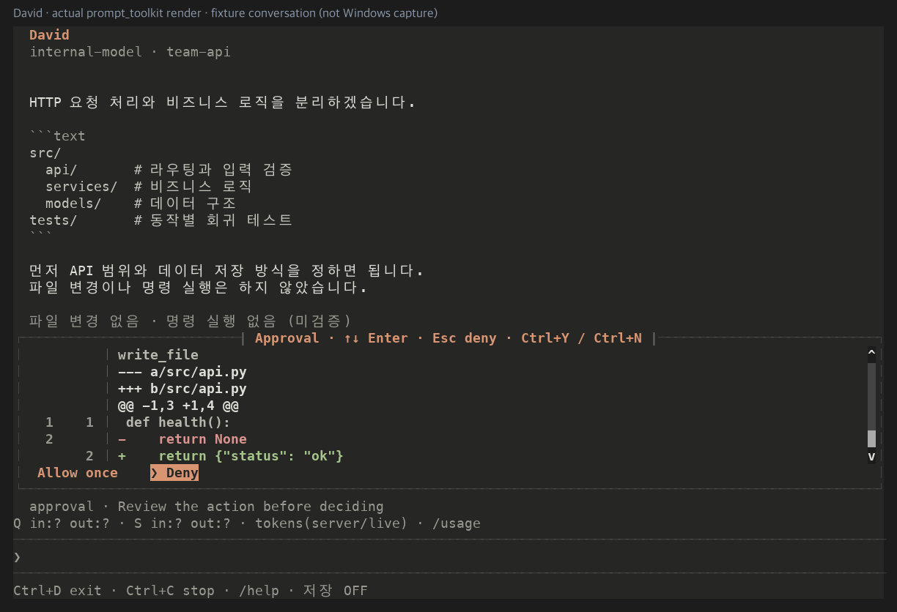

# 터미널 사용성

## 답변 복사와 선택

- `/copy`: 마지막 **완료된** 에이전트 답변 전체를 클립보드에 복사합니다. 생성 중인 미확정 응답은 복사 대상으로 확정하지 않습니다.
- `/select`: 읽기 전용 답변 선택 화면으로 이동합니다. Ctrl+Space로 선택 시작점을 지정하고 방향키로 범위를 늘린 뒤 Ctrl+B로 복사합니다. Esc로 대화 화면에 돌아옵니다.
- Ctrl+C는 선택 화면에서도 복사가 아니라 취소/종료입니다. Ctrl+D도 종료 키입니다.
- 터미널 자체의 Shift+마우스 선택과 Ctrl+Shift+C 지원은 터미널 설정에 따라 다릅니다. 내장 선택 화면은 물리 마우스 동작에 의존하지 않는 대안입니다.

복사는 사용자가 명시적으로 실행한 경우에만 동작합니다. Windows PowerShell Set-Clipboard, macOS pbcopy, Linux wl-copy/xclip을 사용하며 답변 내용은 UTF-8 표준입력으로 전달합니다. 답변을 shell 명령에 끼워 넣지 않고 OSC52를 자동 출력하지 않습니다. 도구가 없거나 클립보드 접근이 실패하면 실패를 표시합니다. OS 클립보드 기록/동기화 기능이 켜져 있다면 복사한 코드가 그 기능의 관리 대상이 될 수 있습니다.

## 이전 입력 탐색

입력창의 첫 표시 줄에서 ↑를 누르면 이전 요청을 불러오고, 마지막 표시 줄에서 ↓를 누르면 다음 요청으로 이동합니다. 이력을 끝까지 내려오면 탐색 전에 작성하던 초안이 복원됩니다. 여러 줄/자동 줄바꿈 입력의 중간에서는 방향키가 커서를 이동합니다.

이력은 승인된 도구 명령이 아니라 사용자가 전송해 수락된 프롬프트만 담습니다. 승인 응답과 slash 명령은 제외하며, 메모리에서 최대 100개/100,000자로 제한합니다. 입력 이력을 별도 파일에 자동 저장하지 않습니다.

## 선택형 승인과 diff

승인 요청은 `Allow once` / `Deny` 선택 목록으로 표시합니다.

- 기본 선택은 **Deny**입니다.
- 방향키로 선택한 뒤 Enter로 결정합니다. 승인 화면이 나타나기 전에 입력한 Enter나 기존 초안이 승인이 되지 않도록, 메뉴 확인에는 새로운 선택 동작이 필요합니다.
- Esc / Ctrl+N은 거절, Ctrl+Y는 해당 요청 한 번만 승인합니다.
- PgUp/PgDn으로 상세 내용을 스크롤합니다. 파일 변경은 경로·unified diff·추가/삭제 색상·hunk에서 계산한 이전/새 행번호를 확인하세요. diff가 아닌 명령 미리보기 등에 행번호를 만들어 붙이지 않습니다.
- Ctrl+C 취소, Ctrl+D/Ctrl+Q 종료, `/quit`/`/exit`는 승인 중에도 사용 가능합니다.

기존 host 승인·경로 검사·변경 전 해시 검사를 유지합니다. UI 선택 메뉴는 자동 승인이나 OS 샌드박스를 추가하지 않습니다. 이미 완료한 변경은 거절/취소/종료해도 자동으로 되돌리지 않습니다.

## 진행 상태와 오류

연결, 서버 응답 대기, reasoning 수신, 답변 생성 등 **실제 이벤트가 확인된 단계**를 표시합니다. 진행 표시와 시간은 UI가 살아 있음을 보여주는 것이며 GPU가 작업 중임을 증명하지 않습니다. 서버가 reasoning 필드를 보내지 않으면 단순 대기를 thinking이라고 추측하지 않습니다. 원시 reasoning 내용은 화면 이벤트에 포함하지 않습니다.

오류는 신뢰된 오류 메타데이터에 따라 빨간 `ERROR`로 표시합니다. 모델이 일반 답변에 `ERROR`라는 단어를 쓴 것만으로 시스템 오류가 되지는 않습니다. mono 테마에서도 라벨로 구분합니다.

현재 문맥과 서버 보고 사용량 상세는 `/usage`에서 확인합니다. **현재 문맥의 토큰 수**, **이번 질문의 여러 API 요청 사용량**, **세션 전체 누적 사용량**은 다른 수치입니다. 서버가 사용량을 보고하지 않으면 unknown이며, 취소/실패 등으로 일부 요청만 보고되었으면 PARTIAL입니다. reasoning/cache 토큰은 서버의 입력/출력에 포함된 부분량이므로 무조건 다시 더하지 않습니다.

사용량 카운터는 현재 실행 중인 세션의 메모리 값입니다. 새 세션·resume·reload에서는 초기화하고 `/clear`는 문맥만 초기화해 누적 사용량을 유지합니다. 저장된 세션의 과거 사용량을 재구성한 값이 아닙니다.

## Windows 검증 범위

개발 호스트에서 실제 Application 렌더/키 입력 및 POSIX PTY 프로세스 검증을 수행합니다. Windows 전용 클립보드 명령의 인자/표준입력은 mock으로 검사하며, 이는 실제 Windows 콘솔·IME·클립보드·마우스 검증과 다릅니다. 사용자 장비에서 복사한 한글/줄바꿈, 방향키 이력, 승인 선택, 종료를 추가 확인해야 합니다.
